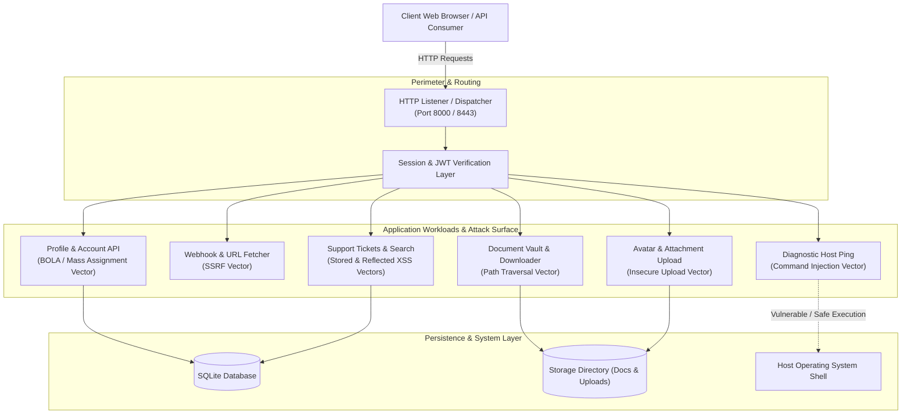

# SWYNEX-Web-Security-Review

[](docs/SECURITY_ASSESSMENT_REPORT.md)
[-brightgreen.svg)](tests/test_web_security_controls.py)
[](docs/RULES_OF_ENGAGEMENT.md)
[-success.svg)](docs/REMEDIATION_GUIDE.md)
[](requirements.txt)
[](LICENSE)

> **Assessment Repository:** `SWYNEX-Web-Security-Review`  
> **Lead Security Assessor:** Fardeen Akmal (SWYNEX Technologies Internship)  
> **Environment:** Authorized Isolated Educational Testbed (`127.0.0.1` / Localhost)  
> **Methodology:** OWASP Web Security Testing Guide (WSTG v4.2) / NIST SP 800-115  
> **LinkedIn Post Draft:** [LinkedIn Post Template](docs/LINKEDIN_POST.md)  

---

## 🛡️ Executive Overview

This repository contains the complete deliverables for the **SWYNEX Web Security Review** (Task 3). Executed within an authorized, isolated educational laboratory environment, this project provides a comprehensive defensive evaluation of common web application security flaws across backend application logic, session architecture, API authorization boundaries, input pipelines, and infrastructure response headers.

### Core Capabilities & Deliverables
1. **Authorized Dual-Mode Laboratory Architecture (`lab/`):**
   - **`lab/vulnerable_app/` (Port 8000):** Intentionally vulnerable enterprise portal (**SWYNEX CloudPortal**) demonstrating critical web flaws across classical injection, broken access control, SSRF, and misconfiguration.
   - **`lab/secure_app/` (Port 8443):** Hardened reference application demonstrating production-grade defense-in-depth mitigations.
2. **Automated Defensive Security Auditor (`tools/web_security_auditor.py`):**
   - Evaluates HTTP security headers (`CSP`, `HSTS`, `X-Frame-Options`, `X-Content-Type-Options`, `Referrer-Policy`, `Permissions-Policy`).
   - Audits session cookie directives (`HttpOnly`, `Secure`, `SameSite`).
   - Assesses CORS configurations and origin reflection with credentials.
   - Inspects error handling for stack trace leaks and computes quantitative security compliance grades.
3. **Formal Assessment & SOC Documentation (`docs/` & `reports/`):**
   - Master technical report ([docs/SECURITY_ASSESSMENT_REPORT.md](docs/SECURITY_ASSESSMENT_REPORT.md)).
   - Executive briefing & strategic roadmap ([docs/EXECUTIVE_SUMMARY.md](docs/EXECUTIVE_SUMMARY.md)).
   - Developer remediation guide ([docs/REMEDIATION_GUIDE.md](docs/REMEDIATION_GUIDE.md)).
   - Formal rules of engagement & authorization letter ([docs/RULES_OF_ENGAGEMENT.md](docs/RULES_OF_ENGAGEMENT.md)).
   - Individual technical finding dossiers in [reports/findings/](reports/findings/).
4. **Continuous Automated Verification (`tests/test_web_security_controls.py`):**
   - 15 automated unit and integration tests achieving **100% test pass rate** in under 5 seconds.
5. **Zero External Dependencies:** Built entirely with the standard library of **Python 3.8+** (zero external pip packages required to run the labs, execute the auditor, or pass all tests).

---

## 🌐 Application Architecture & Attack Surface



---

## 📋 Summary of Findings & Threat Dossiers

Every identified vulnerability has been thoroughly documented across affected endpoints, CVSS v3.1 scoring, technical mechanics, and concrete mitigations:

| Finding ID | Finding Title | OWASP Category | CWE | CVSS v3.1 | Affected Component | Recommended Mitigation | Status |
| :--- | :--- | :--- | :--- | :---: | :--- | :--- | :---: |
| **[SEC-WEB-001](reports/findings/SEC-WEB-001-Command-Injection-RCE.md)** | **OS Command Injection (RCE)** | A03: Injection | CWE-78 | **9.8** (Crit) | `POST /api/tools/ping` | RFC 1123 hostname regex; vectorized subprocess (`shell=False`) | **REMEDIATED** |
| **[SEC-WEB-002](reports/findings/SEC-WEB-002-Server-Side-Request-Forgery-SSRF.md)** | **Server-Side Request Forgery** | A10: SSRF | CWE-918 | **8.6** (Crit) | `POST /api/tools/fetch-url` | DNS resolution check; private/loopback/cloud IP blocking; redirect suppression | **REMEDIATED** |
| **[SEC-WEB-003](reports/findings/SEC-WEB-003-Cross-Site-Scripting-XSS.md)** | **Stored & Reflected XSS** | A03: Injection | CWE-79 | **6.1** (Med) | `GET /search`<br>`GET/POST /tickets` | Context-aware HTML entity encoding (`html.escape`); strict Content-Security-Policy | **REMEDIATED** |
| **[SEC-WEB-004](reports/findings/SEC-WEB-004-Path-Traversal-Arbitrary-File-Read.md)** | **Path Traversal File Read** | A01: Broken Access Control | CWE-22 | **7.5** (High) | `GET /api/documents/download` | Reject traversal sequences; `os.path.realpath` canonicalization boundary checks | **REMEDIATED** |
| **[SEC-WEB-005](reports/findings/SEC-WEB-005-Unrestricted-File-Upload.md)** | **Unrestricted File Upload** | A04: Insecure Design | CWE-434 | **7.8** (High) | `POST /api/upload` | Extension whitelist (`.png`, `.jpg`), magic byte verification, UUID file naming | **REMEDIATED** |
| **[SEC-WEB-006](reports/findings/SEC-WEB-006-BOLA-IDOR-and-Mass-Assignment.md)** | **BOLA / IDOR & Mass Assignment** | A01: Broken Access Control | CWE-639<br>CWE-915 | **8.8** (Crit) | `GET/PUT /api/user/profile` | Contextual session identity validation; strict DTO allowlisting | **REMEDIATED** |
| **[SEC-WEB-007](reports/findings/SEC-WEB-007-Broken-Authentication-Weak-JWT.md)** | **Broken Auth & Weak JWT** | A07: Auth Failures | CWE-287<br>CWE-347 | **8.1** (High) | Global Session Layer | HS256 algorithm enforcement; salted PBKDF2 hashing; `HttpOnly; Secure; SameSite` cookies | **REMEDIATED** |
| **[SEC-WEB-008](reports/findings/SEC-WEB-008-Security-Misconfiguration-Insecure-CORS.md)** | **Insecure CORS & Missing Headers** | A05: Security Misconfig | CWE-942<br>CWE-16 | **6.5** (Med) | Global HTTP Pipeline | Explicit CORS whitelist; full baseline of 7 security headers; generic error handling | **REMEDIATED** |

---

## 🚀 Quickstart Guide

### 1. Launching the Laboratory Applications

#### Vulnerable Application (Port 8000)
```bash
python3 -m lab.vulnerable_app.server 8000
```
- Web Interface: [http://127.0.0.1:8000/](http://127.0.0.1:8000/)

#### Hardened Secure Application (Port 8443)
```bash
python3 -m lab.secure_app.server 8443
```
- Web Interface: [http://127.0.0.1:8443/](http://127.0.0.1:8443/)

---

### 2. Running the Automated Verification Test Suite

Execute the 15 automated security control tests verifying both vulnerable flaws and defense-in-depth mitigations:

```bash
python3 -m unittest tests/test_web_security_controls.py -v
```

Expected output:
```
Ran 15 tests in 4.088s

OK (100% Passed)
```

---

### 3. Running the Automated Defensive Security Auditor

Scan a web server to evaluate compliance with HTTP security headers, cookies, and CORS policies:

```bash
# Audit the vulnerable testbed
python3 -m tools.web_security_auditor --target http://127.0.0.1:8000 --output vuln_audit.json

# Audit the hardened testbed
python3 -m tools.web_security_auditor --target http://127.0.0.1:8443 --output secure_audit.json
```

---

## 📂 Repository Directory Layout

```
SWYNEX-Web-Security-Review/
├── .gitignore                          # Clean VCS exclusions
├── LICENSE                             # MIT Open-Source License
├── README.md                           # Master overview and quickstart guide
├── requirements.txt                    # Project requirements (Python stdlib)
├── docs/                               # Formal Assessment Documentation
│   ├── RULES_OF_ENGAGEMENT.md          # Authorization letter, scope, and ethical bounds
│   ├── SECURITY_ASSESSMENT_REPORT.md   # Master technical assessment report
│   ├── EXECUTIVE_SUMMARY.md            # C-Suite risk overview & 30/60/90-day roadmap
│   ├── REMEDIATION_GUIDE.md            # Side-by-side developer code diffs & best practices
│   └── LINKEDIN_POST.md                # Professional announcement post template
├── lab/                                # Authorized Local Testbed
│   ├── README.md                       # Detailed laboratory guide and seed accounts
│   ├── vulnerable_app/                 # Flawed baseline service (Port 8000)
│   │   ├── database.py                 # Insecure database model with MD5 & Mass Assignment
│   │   ├── server.py                   # Intentionally vulnerable HTTP server
│   │   ├── documents/                  # Target files for path traversal demonstration
│   │   └── uploads/                    # Target directory for unrestricted uploads
│   └── secure_app/                     # Hardened reference implementation (Port 8443)
│       ├── database.py                 # Hardened database with salted PBKDF2 & DTO allowlists
│       ├── security_controls.py        # Defense-in-depth sanitizers, validators, & JWT engine
│       ├── server.py                   # Hardened HTTP server with full security headers
│       ├── documents/                  # Guarded documents repository
│       └── uploads/                    # Protected upload directory
├── reports/
│   └── findings/                       # Individual Technical Finding Dossiers
│       ├── SEC-WEB-001-Command-Injection-RCE.md
│       ├── SEC-WEB-002-Server-Side-Request-Forgery-SSRF.md
│       ├── SEC-WEB-003-Cross-Site-Scripting-XSS.md
│       ├── SEC-WEB-004-Path-Traversal-Arbitrary-File-Read.md
│       ├── SEC-WEB-005-Unrestricted-File-Upload.md
│       ├── SEC-WEB-006-BOLA-IDOR-and-Mass-Assignment.md
│       ├── SEC-WEB-007-Broken-Authentication-Weak-JWT.md
│       └── SEC-WEB-008-Security-Misconfiguration-Insecure-CORS.md
├── tests/                              # Automated Verification Suite
│   └── test_web_security_controls.py   # 15 automated security control tests
└── tools/                              # Defensive Security Tools
    └── web_security_auditor.py         # Automated security compliance scanner
```

---

## 👥 Seed Testbed Accounts

| Username | Plaintext Password | Role | Permissions |
| :--- | :--- | :--- | :--- |
| **`admin`** | `AdminP@ss2026!` | `admin` | Chief Security Officer; access to all confidential records and audit logs. |
| **`alice`** | `AliceDevPassword99` | `developer` | Lead Cloud Architect; developer access to architecture specifications. |
| **`bob`** | `BobUserPass123` | `user` | External contractor; unprivileged standard account. |

---

## ⚖️ Ethical Conduct & Safe Harbor Notice

All activities documented in this repository were conducted within an authorized, isolated local laboratory testbed in strict compliance with the [Rules of Engagement](docs/RULES_OF_ENGAGEMENT.md). No third-party or production systems were targeted or accessed.

- **Lead Assessor:** Fardeen Akmal  
- **Contact:** `fardeenakmal123@gmail.com`  
- **Project:** SWYNEX Web Security Review (Task 3)  

