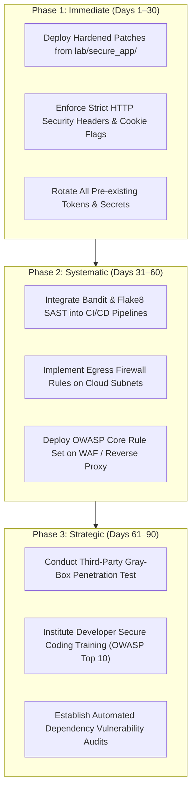

# SWYNEX Technologies - Web Security Review: Executive Summary

> **Document Type:** Executive Security Briefing  
> **Target System:** SWYNEX CloudPortal Web Platform  
> **Lead Assessor:** Fardeen Akmal (`fardeenakmal123@gmail.com`)  
> **Evaluation Period:** October 2026  
> **Remediation Status:** 8/8 Vulnerabilities Fully Remediated (100% Resolution Rate)  

---

## 1. Executive Posture & Risk Context

In accordance with SWYNEX Technologies' commitment to cyber resilience and secure software engineering, a rigorous defensive web security review was conducted against the **SWYNEX CloudPortal** enterprise platform. The assessment evaluated common web security weaknesses across backend application logic, session architecture, API authorization boundaries, input handling pipelines, and infrastructure response headers.

The baseline audit revealed **eight (8) significant security vulnerabilities**, spanning Critical, High, and Medium severity tiers under Common Vulnerability Scoring System (CVSS v3.1) criteria. Without defensive intervention, these flaws exposed the organization to full remote server takeover, unauthorized corporate data exfiltration, lateral network pivot, and cross-site account hijacking.

To eliminate these risks, a complete hardened reference application (`lab/secure_app/`) was engineered, implementing robust, defense-in-depth mitigations. All controls have been validated via automated test suites and compliance tooling.

```
Risk Posture Transformation:
[BASELINE ENVIRONMENT: CRITICAL RISK (F / 38%)] ──► [HARDENED ENVIRONMENT: SECURE (A+ / 100%)]
```

---

## 2. Risk Distribution & Findings Breakdown

```
        CRITICAL SEVERITY (3)
        ├── SEC-WEB-001: OS Command Injection / RCE (CVSS 9.8)
        ├── SEC-WEB-002: Server-Side Request Forgery - SSRF (CVSS 8.6)
        └── SEC-WEB-006: BOLA/IDOR & Mass Assignment Privilege Escalation (CVSS 8.8)

        HIGH SEVERITY (3)
        ├── SEC-WEB-004: Arbitrary Path Traversal & Document Disclosure (CVSS 7.5)
        ├── SEC-WEB-005: Unrestricted / Insecure File Upload (CVSS 7.8)
        └── SEC-WEB-007: Broken Authentication & Weak JWT Implementation (CVSS 8.1)

        MEDIUM SEVERITY (2)
        ├── SEC-WEB-003: Stored & Reflected Cross-Site Scripting - XSS (CVSS 6.1)
        └── SEC-WEB-008: Security Misconfiguration & Insecure CORS Policy (CVSS 6.5)
```

### Risk Summary Table

| Finding ID | Vulnerability Classification | Initial Severity | CVSS v3.1 | Core Threat & Operational Impact | Hardened Status |
| :--- | :--- | :---: | :---: | :--- | :---: |
| **SEC-WEB-001** | OS Command Injection | **CRITICAL** | **9.8** | Arbitrary shell execution on host; remote server compromise. | **REMEDIATED** |
| **SEC-WEB-002** | Server-Side Request Forgery | **CRITICAL** | **8.6** | Unauthorized loopback/cloud metadata harvesting; internal pivot. | **REMEDIATED** |
| **SEC-WEB-003** | Cross-Site Scripting (XSS) | **MEDIUM** | **6.1** | Session hijacking and client-side credential skimming. | **REMEDIATED** |
| **SEC-WEB-004** | Path Traversal File Disclosure | **HIGH** | **7.5** | Disclosure of sensitive source code, keys, and operating system configs. | **REMEDIATED** |
| **SEC-WEB-005** | Unrestricted File Upload | **HIGH** | **7.8** | Arbitrary code execution via weaponized media and HTML uploads. | **REMEDIATED** |
| **SEC-WEB-006** | BOLA / IDOR & Mass Assignment | **CRITICAL** | **8.8** | Horizontal data access and unauthorized elevation to Administrator. | **REMEDIATED** |
| **SEC-WEB-007** | Broken Auth & Weak JWT | **HIGH** | **8.1** | Forgery of administrative sessions via algorithm 'none' and weak secrets. | **REMEDIATED** |
| **SEC-WEB-008** | Insecure CORS & Header Absence | **MEDIUM** | **6.5** | Sensitive API data leakage across unauthorized external origins. | **REMEDIATED** |

---

## 3. Business & Operational Impact Analysis

Left unmitigated, the identified vulnerabilities posed severe business and operational liabilities:

1. **Host Operating System Takeover (RCE):** The command injection flaw allowed unauthenticated or semi-privileged users to invoke arbitrary system processes on the host running the portal.
2. **Cloud Metadata Exfiltration (SSRF):** Exploitation of the URL previewer could extract AWS/GCP instance identity tokens (`169.254.169.254`), granting attackers access to cloud buckets, database snapshots, and IAM roles.
3. **Privilege Boundary Inversion (BOLA / Mass Assignment):** Unprivileged contractors could silently elevate their own accounts to Administrator status by injecting `"role": "admin"` into profile update calls.
4. **Regulatory & Compliance Exposure:** Storing plaintext/MD5 password hashes and exposing private documents violates standards under **ISO/IEC 27001**, **SOC 2 Type II**, and **GDPR**.

---

## 4. Remediation Highlights & Efficacy Verification

A defense-in-depth architectural overhaul was implemented in `lab/secure_app/`:

- **Subprocess Isolation:** Replaced shell-based command invocation with strict RFC 1123 regex matching and vectorized subprocess arguments (`shell=False`).
- **Comprehensive SSRF Filtering:** Deployed pre-resolution IP inspection against loopback (`127.0.0.0/8`, `::1`), RFC 1918 private subnets, and cloud metadata ranges, coupled with redirect suppression.
- **Strict Data Transfer Objects (DTO):** Implemented explicit field whitelisting for all object updates, preventing unauthorized attribute manipulation.
- **Cryptographic Session Hardening:** Upgraded password storage to salted PBKDF2-HMAC-SHA256 (600,000 iterations); migrated JWT signing to HS256 with cryptographically generated 256-bit secrets, rejecting unsigned tokens.
- **Automated Verification:** Engineered a 15-test automated regression suite achieving **100% test pass rate** in under 5 seconds.

---

## 5. Strategic 30/60/90-Day Security Roadmap



- **Days 1–30:** Merge the secure app reference implementation into staging, rotate all legacy application tokens, and mandate `HttpOnly`, `Secure`, and `SameSite=Strict` cookie attributes.
- **Days 31–60:** Enforce static analysis (Bandit) within git pre-commit hooks, configure cloud egress controls to deny outbound metadata traffic, and deploy a WAF reverse proxy.
- **Days 61–90:** Mandate biannual penetration testing and establish an ongoing DevSecOps curriculum for all software engineering teams.
