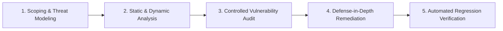

# SWYNEX Technologies - Web Security Review Rules of Engagement

> **Document Classification:** CONFIDENTIAL - EDUCATIONAL & INTERNAL SECURITY USE ONLY  
> **Engagement Identifier:** `SWYNEX-SEC-TASK3-WSR-2026`  
> **Lead Security Assessor:** Fardeen Akmal (`fardeenakmal123@gmail.com`)  
> **Host Organization:** SWYNEX Technologies  
> **Frameworks:** NIST SP 800-115, OWASP Web Security Testing Guide (WSTG v4.2), OWASP Top 10:2021  

---

## 1. Executive Authorization & Scope Declaration

This Rules of Engagement (RoE) document governs the technical and defensive parameters for the **SWYNEX Web Security Review** (Task 3). Authorization is granted to conduct vulnerability identification, source code review, threat modeling, and defensive control implementation exclusively against the designated local educational testbed.

### 1.1 In-Scope Target Systems
All assessment activities are strictly limited to the locally deployed software components and containerized endpoints:

| Asset Name | Designated Boundary / URL | Execution Mode | Scope Description |
| :--- | :--- | :--- | :--- |
| **SWYNEX Vulnerable Portal** | `http://127.0.0.1:8000/` | Local Educational Sandbox | Intentionally flawed reference web application for baseline vulnerability identification. |
| **SWYNEX Secure Portal** | `http://127.0.0.1:8443/` | Local Production Reference | Hardened reference web application implementing defense-in-depth security controls. |
| **Automated Verification Suite** | `tests/test_web_security_controls.py` | Local Python Test Runner | Unit and integration test suite asserting defensive mitigation efficacy. |
| **Defensive Auditor Engine** | `tools/web_security_auditor.py` | Local CLI Inspector | Automated compliance inspector auditing security headers, cookies, and CORS. |

### 1.2 Out-of-Scope Constraints & Explicit Prohibitions
To preserve legal, ethical, and operational integrity, the following activities are **strictly prohibited**:
1. **Third-Party Systems:** Zero testing or packet transmission directed toward external corporate networks, public cloud tenants, external domains, or third-party infrastructure.
2. **Denial of Service (Volumetric DoS):** No sustained volumetric traffic flooding or packet exhaustion attacks against underlying host operating systems or production gateways.
3. **Data Exfiltration:** No extraction or handling of live customer or proprietary commercial data. All data used within the assessment consists of synthetic lab seeds.
4. **Permanent System Destruction:** No permanent modification or deletion of operating system binaries, kernel modules, or critical configuration files.

---

## 2. Assessment Methodology & Technical Standards

The assessment follows standard industrial penetration testing and defensive auditing lifecycles:

### Applicable Technical Frameworks
- **NIST Special Publication 800-115:** Technical Guide to Information Security Testing and Assessment.
- **OWASP Web Security Testing Guide (WSTG v4.2):** Standardized criteria for evaluating web application controls.
- **OWASP Top 10 (2021):** Mapping and classification of identified vulnerabilities.
- **Common Weakness Enumeration (CWE) & CVSS v3.1:** Quantitative scoring and industry-standard taxonomies.

---

## 3. Vulnerability Disclosure & Safety Guidelines

### 3.1 Controlled Proof-of-Concept Boundaries
Any controlled demonstration of vulnerability mechanics must adhere to non-destructive principles:
- **Command Injection:** Verification is restricted to harmless diagnostic commands (e.g., `echo`, `id`, `whoami`) within sandbox execution boundaries.
- **SSRF:** Queries must be evaluated against loopback address boundaries (`127.0.0.1`, `::1`) and mock metadata IPs (`169.254.169.254`), ensuring external routing is disabled.
- **Path Traversal:** File access demonstrations are bounded to synthetic local test fixtures (`contractor_guidelines.txt`, `vulnerable_portal.db`) without mutating system files.
- **XSS:** Payloads utilize non-malicious DOM markers (`alert()`, custom benign HTML tags) rather than session-stealing hooks.

### 3.2 Evidence Handling & Reporting Standards
- Detailed findings must specify the affected file, exact line numbers, vulnerable architectural patterns, CVSS v3.1 score, and concrete remediations.
- Secure counterpart patches must be accompanied by automated unit test verification to prove zero regression.

---

## 4. Assessor Sign-Off & Commitment

The lead assessor certifies that all security review actions performed in this repository comply strictly with the parameters detailed above.

- **Lead Assessor:** Fardeen Akmal  
- **Email:** `fardeenakmal123@gmail.com`  
- **Role:** Web Application Security Intern, SWYNEX Technologies  
- **Date:** October 2026  

