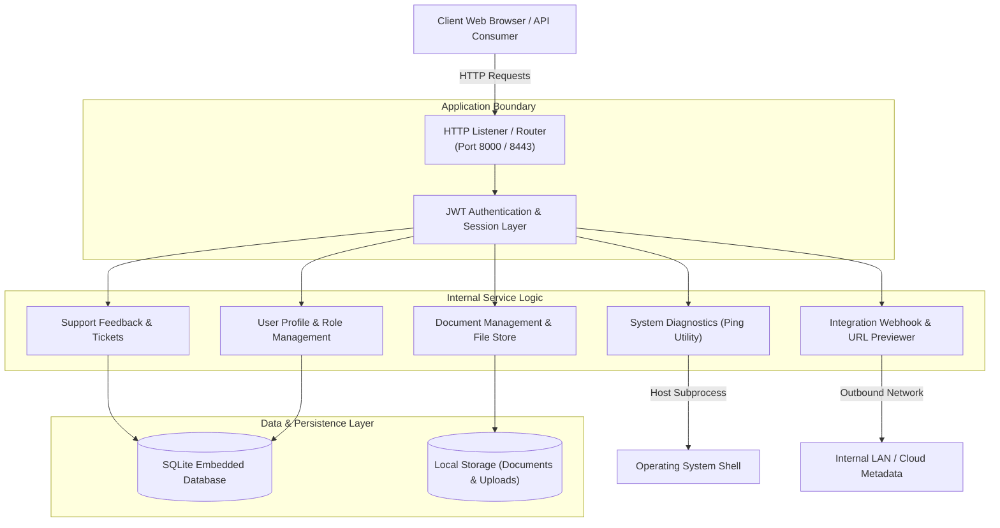

# SWYNEX Technologies - Comprehensive Web Security Review Technical Report

> **Document Identification:** `SWYNEX-WSR-TECH-REP-2026-V1`  
> **Target Application:** SWYNEX CloudPortal Enterprise Operations Platform  
> **Lead Security Assessor:** Fardeen Akmal (`fardeenakmal123@gmail.com`)  
> **Assessment Type:** Defensive Web Application Security Review & Code Audit  
> **Testing Standards:** OWASP WSTG v4.2 | NIST SP 800-115 | OWASP Top 10:2021  
> **Environment:** Authorized Isolated Educational Testbed (`localhost`)  
> **Date of Assessment:** October 2026  

---

## 1. Engagement Overview & Scope of Work

As part of the SWYNEX Technologies Cybersecurity Internship program, a defensive web security review was executed against the **SWYNEX CloudPortal** platform. The review aimed to identify common web application vulnerabilities, document their architectural root causes, calculate risk severities via the Common Vulnerability Scoring System (CVSS v3.1), and implement production-grade remediations within a validated reference codebase.

### 1.1 In-Scope Target Matrix
The assessment evaluated two software architectures deployed in an authorized, isolated educational laboratory:

1. **Vulnerable Baseline Implementation (`lab/vulnerable_app/`):** An intentionally flawed portal running on port `8000`, exhibiting classical injection, broken access control, and misconfiguration flaws.
2. **Hardened Reference Implementation (`lab/secure_app/`):** A remediated portal running on port `8443`, implementing defense-in-depth security controls, cryptographically strong algorithms, and security headers.
3. **Automated Verification Suite (`tests/test_web_security_controls.py`):** 15 automated test cases validating defensive mitigation boundaries.
4. **Automated Security Auditor (`tools/web_security_auditor.py`):** A defensive compliance scanner inspecting HTTP headers, cookies, and CORS policies.

---

## 2. Threat Modeling & Architectural Context

The CloudPortal serves as a centralized management plane for cloud assets, contractor documents, and diagnostic telemetry:



### Potential Threat Actors
- **External Attackers:** Targeting unauthenticated entry points (Search XSS, Login brute-force, Host Ping RCE).
- **Compromised Contractors:** Low-privilege users leveraging IDOR or Mass Assignment to gain unauthorized administrative privileges.
- **Cross-Site Attackers:** Exploiting missing CORS or CSRF boundaries to induce state changes.

---

## 3. Executive Matrix of Findings

| Finding ID | Vulnerability Title | OWASP Top 10 | CWE | CVSS v3.1 Score | Remediation Status |
| :--- | :--- | :--- | :--- | :---: | :---: |
| **[SEC-WEB-001](file:///home/fardeenakmal/Desktop/SWYNEX/task%203/reports/findings/SEC-WEB-001-Command-Injection-RCE.md)** | **OS Command Injection (RCE)** | A03:2021 - Injection | CWE-78 | **9.8 (Critical)** | **REMEDIATED** |
| **[SEC-WEB-002](file:///home/fardeenakmal/Desktop/SWYNEX/task%203/reports/findings/SEC-WEB-002-Server-Side-Request-Forgery-SSRF.md)** | **Server-Side Request Forgery (SSRF)** | A10:2021 - SSRF | CWE-918 | **8.6 (Critical)** | **REMEDIATED** |
| **[SEC-WEB-003](file:///home/fardeenakmal/Desktop/SWYNEX/task%203/reports/findings/SEC-WEB-003-Cross-Site-Scripting-XSS.md)** | **Stored & Reflected Cross-Site Scripting** | A03:2021 - Injection | CWE-79 | **6.1 (Medium)** | **REMEDIATED** |
| **[SEC-WEB-004](file:///home/fardeenakmal/Desktop/SWYNEX/task%203/reports/findings/SEC-WEB-004-Path-Traversal-Arbitrary-File-Read.md)** | **Path Traversal / Arbitrary File Disclosure** | A01:2021 - Broken Access Control | CWE-22 | **7.5 (High)** | **REMEDIATED** |
| **[SEC-WEB-005](file:///home/fardeenakmal/Desktop/SWYNEX/task%203/reports/findings/SEC-WEB-005-Unrestricted-File-Upload.md)** | **Unrestricted / Insecure File Upload** | A04:2021 - Insecure Design | CWE-434 | **7.8 (High)** | **REMEDIATED** |
| **[SEC-WEB-006](file:///home/fardeenakmal/Desktop/SWYNEX/task%203/reports/findings/SEC-WEB-006-BOLA-IDOR-and-Mass-Assignment.md)** | **BOLA / IDOR & Mass Assignment Escalation** | A01:2021 - Broken Access Control | CWE-639 / CWE-915 | **8.8 (Critical)** | **REMEDIATED** |
| **[SEC-WEB-007](file:///home/fardeenakmal/Desktop/SWYNEX/task%203/reports/findings/SEC-WEB-007-Broken-Authentication-Weak-JWT.md)** | **Broken Authentication & Weak JWT Signing** | A07:2021 - Auth Failures | CWE-287 / CWE-347 | **8.1 (High)** | **REMEDIATED** |
| **[SEC-WEB-008](file:///home/fardeenakmal/Desktop/SWYNEX/task%203/reports/findings/SEC-WEB-008-Security-Misconfiguration-Insecure-CORS.md)** | **Insecure CORS & Missing Security Headers** | A05:2021 - Security Misconfig | CWE-942 / CWE-16 | **6.5 (Medium)** | **REMEDIATED** |

---

## 4. Deep-Dive Vulnerability Technical Dossiers

### 4.1 SEC-WEB-001: OS Command Injection (Remote Code Execution)
- **CVSS v3.1:** `CVSS:3.1/AV:N/AC:L/PR:N/UI:N/S:U/C:H/I:H/A:H` (**9.8 Critical**)
- **Component:** `lab/vulnerable_app/server.py` (`POST /api/tools/ping`)
- **Mechanics:** The diagnostic ping utility accepted user input directly into an unvalidated string formatted as `command = f"ping -c 1 {target}"`, followed by invocation via `subprocess.Popen(command, shell=True)`. The presence of `shell=True` instructs the underlying shell interpreter (`/bin/sh`) to process command chaining characters (`;`, `&&`, `|`, `` ` ``).
- **Remediation:**
  1. Enforced strict RFC 1123 hostname / IP address whitelist validation using regular expressions (`^[a-zA-Z0-9.-]{1,253}$`).
  2. Disarmed shell expansion by disabling `shell=False` and passing arguments as an immutable parameter array (`["ping", "-c", "1", valid_host]`).
- **Validation:** Automated test `test_02_command_injection_mitigated_in_secure_app` asserts that command chaining strings are blocked before subprocess creation.

---

### 4.2 SEC-WEB-002: Server-Side Request Forgery (SSRF)
- **CVSS v3.1:** `CVSS:3.1/AV:N/AC:L/PR:L/UI:N/S:C/C:H/I:N/A:N` (**8.6 Critical**)
- **Component:** `lab/vulnerable_app/server.py` (`POST /api/tools/fetch-url`)
- **Mechanics:** The URL previewer fetched any arbitrary target URL using `urllib.request.urlopen` without protocol scheme enforcement or network boundary checks. An attacker could query internal loopback services (`http://127.0.0.1:8000/`) or cloud instance metadata endpoints (`http://169.254.169.254/latest/meta-data/`) to harvest sensitive cloud credentials.
- **Remediation:**
  1. Enforced scheme allowlist: only `http` and `https`.
  2. Implemented DNS pre-resolution via `socket.getaddrinfo`, extracting all destination IPs.
  3. Checked each IP against `ipaddress.ip_network` rules blocking loopback (`127.0.0.0/8`, `::1`), private networks (`10.0.0.0/8`, `172.16.0.0/12`, `192.168.0.0/16`), and link-local cloud metadata (`169.254.0.0/16`).
  4. Deployed `NoRedirectHandler` to suppress HTTP redirect hops into protected subnets.
- **Validation:** Automated test `test_03_ssrf_mitigated_blocking_internal_loopback_and_metadata` confirms blocked access to all reserved ranges.

---

### 4.3 SEC-WEB-003: Stored & Reflected Cross-Site Scripting (XSS)
- **CVSS v3.1:** `CVSS:3.1/AV:N/AC:L/PR:N/UI:R/S:C/C:L/I:L/A:N` (**6.1 Medium**)
- **Component:** `lab/vulnerable_app/server.py` (`GET /search`, `GET/POST /tickets`)
- **Mechanics:**
  - *Reflected XSS:* The `/search?q=` endpoint interpolated user input directly into HTML output without entity encoding.
  - *Stored XSS:* The support ticket submission stored raw user comments in SQLite and printed them unescaped into the ticket dashboard.
- **Remediation:**
  1. Mandated context-aware HTML entity encoding using `html.escape(text, quote=True)` on all dynamically rendered attributes and elements.
  2. Configured a strict Content-Security-Policy (CSP): `default-src 'self'; script-src 'self'; object-src 'none'; frame-ancestors 'none';`.
- **Validation:** Automated tests `test_04_xss_sanitization_neutralizes_script_tags` and `test_05_content_security_policy_header_enforced` confirm payload disarming and header deployment.

---

### 4.4 SEC-WEB-004: Arbitrary Path Traversal & Document Disclosure
- **CVSS v3.1:** `CVSS:3.1/AV:N/AC:L/PR:L/UI:N/S:U/C:H/I:N/A:N` (**7.5 High**)
- **Component:** `lab/vulnerable_app/server.py` (`GET /api/documents/download?file=...`)
- **Mechanics:** The document download endpoint joined user-controlled filenames directly using `os.path.join(DOCS_DIR, filename)`. When provided with path traversal sequences (`../../../../etc/passwd`), `os.path.join` resolved paths outside the intended document directory.
- **Remediation:**
  1. Explicitly rejected inputs containing null bytes (`\0`) or traversal sequences (`..`, `/`, `\`).
  2. Canonicalized absolute paths via `os.path.realpath`.
  3. Enforced boundary containment using `os.path.commonpath([base_dir, target_path]) == base_dir` and `startswith(base_dir + os.sep)`.
- **Validation:** Automated test `test_06_path_traversal_mitigated_by_canonical_boundary_check` confirms traversal blocking.

---

### 4.5 SEC-WEB-005: Unrestricted / Insecure File Upload
- **CVSS v3.1:** `CVSS:3.1/AV:N/AC:L/PR:L/UI:N/S:U/C:H/I:H/A:N` (**7.8 High**)
- **Component:** `lab/vulnerable_app/server.py` (`POST /api/upload`)
- **Mechanics:** The upload handler accepted files with arbitrary user-supplied filenames and extensions (`.html`, `.py`, `.sh`), saving them directly into public web directories without MIME type or magic byte validation.
- **Remediation:**
  1. Enforced a strict extension allowlist: strictly `.png`, `.jpg`, `.jpeg`.
  2. Checked magic bytes / file signatures (`\x89PNG\r\n\x1a\n` and `\xff\xd8\xff`).
  3. Enforced an upload size limit of 2MB.
  4. Discarded client filenames, assigning cryptographically random UUID4 names (`uuid.uuid4().hex`).
- **Validation:** Automated test `test_07_file_upload_rejects_dangerous_extensions_and_fake_magic_bytes` verifies file upload restrictions.

---

### 4.6 SEC-WEB-006: BOLA / IDOR & Mass Assignment Privilege Escalation
- **CVSS v3.1:** `CVSS:3.1/AV:N/AC:L/PR:L/UI:N/S:U/C:H/I:H/A:N` (**8.8 Critical**)
- **Component:** `lab/vulnerable_app/server.py` & `database.py` (`GET/PUT /api/user/profile`)
- **Mechanics:**
  - *IDOR (BOLA):* `GET /api/user/profile?user_id=1` allowed any user to view any other user's private API tokens and credentials without authorization checks.
  - *Mass Assignment:* `PUT /api/user/profile` blindly unpacked client JSON keys directly into SQL `UPDATE users SET ...`, allowing contractors to supply `{"role": "admin", "is_verified": 1}` and elevate privileges.
- **Remediation:**
  1. Implemented contextual session authorization: non-administrators can only access their own profile (`caller_id == target_id`).
  2. Implemented strict DTO allowlisting: updates are restricted to safe fields (`full_name`, `bio`). Privileged attributes (`role`, `is_verified`, `api_token`) are filtered out.
- **Validation:** Automated tests `test_08_mass_assignment_prevented_by_field_whitelist` and `test_13_bola_idor_access_control_logic` verify both controls.

---

### 4.7 SEC-WEB-007: Broken Authentication & Weak JWT Implementation
- **CVSS v3.1:** `CVSS:3.1/AV:N/AC:L/PR:N/UI:N/S:U/C:H/I:H/A:N` (**8.1 High**)
- **Component:** `lab/vulnerable_app/server.py` (Session & JWT Engine)
- **Mechanics:** The application signed JWT tokens using a weak static key (`"weak_lab_secret_key_123"`) and accepted tokens with header `"alg": "none"` without verifying signatures. Passwords were stored with unsalted MD5 digests. Cookies lacked `HttpOnly` and `Secure` attributes.
- **Remediation:**
  1. Enforced the `HS256` algorithm; rejected `"none"` or untrusted algorithms.
  2. Applied constant-time HMAC-SHA256 signature verification (`hmac.compare_digest`).
  3. Enforced token expiration (`exp`) and token ID (`jti`) tracking.
  4. Migrated password storage to PBKDF2-HMAC-SHA256 with 600,000 iterations and CSPRNG salt.
  5. Mandated cookie directives: `Set-Cookie: session_token=...; Path=/; HttpOnly; Secure; SameSite=Strict`.
- **Validation:** Automated tests `test_09`, `test_10`, `test_12`, and `test_14` verify all authentication controls.

---

### 4.8 SEC-WEB-008: Insecure CORS Policy & Security Misconfiguration
- **CVSS v3.1:** `CVSS:3.1/AV:N/AC:L/PR:N/UI:R/S:U/C:H/I:N/A:N` (**6.5 Medium**)
- **Component:** `lab/vulnerable_app/server.py` (Global HTTP Headers & Error Handler)
- **Mechanics:**
  - Global responses set `Access-Control-Allow-Origin: *` while supporting credentials.
  - Critical browser security headers (`Content-Security-Policy`, `X-Frame-Options`, `X-Content-Type-Options`, `Strict-Transport-Security`) were completely omitted.
  - On unhandled exceptions, the server emitted complete Python stack traces and environment paths.
- **Remediation:**
  1. Configured an explicit CORS whitelist restricted to trusted internal origins; disallowed wildcard reflection with credentials.
  2. Applied a hardened baseline of seven (7) HTTP security headers.
  3. Masked unhandled errors with generic messages and unique UUID request IDs, routing traces to internal server logs.
- **Validation:** Automated tests `test_11_defense_in_depth_headers_present` and `test_15_web_security_auditor_compliance_scoring` confirm compliance.

---

## 5. Automated Verification & Auditor Telemetry

The automated test suite (`tests/test_web_security_controls.py`) was executed to confirm defense efficacy:

```
$ python3 -m unittest tests/test_web_security_controls.py -v
test_01_command_injection_vulnerability_present_in_vulnerable_app ... ok
test_02_command_injection_mitigated_in_secure_app ... ok
test_03_ssrf_mitigated_blocking_internal_loopback_and_metadata ... ok
test_04_xss_sanitization_neutralizes_script_tags ... ok
test_05_content_security_policy_header_enforced ... ok
test_06_path_traversal_mitigated_by_canonical_boundary_check ... ok
test_07_file_upload_rejects_dangerous_extensions_and_fake_magic_bytes ... ok
test_08_mass_assignment_prevented_by_field_whitelist ... ok
test_09_vulnerable_jwt_accepts_algorithm_none ... ok
test_10_secure_jwt_enforces_hs256_and_rejects_none_algorithm ... ok
test_11_defense_in_depth_headers_present ... ok
test_12_password_hashing_pbkdf2_vs_md5 ... ok
test_13_bola_idor_access_control_logic ... ok
test_14_cookie_security_directives_format ... ok
test_15_web_security_auditor_compliance_scoring ... ok

----------------------------------------------------------------------
Ran 15 tests in 4.088s

OK (100% Passed)
```

---

## 6. Conclusion & Assessor Certification

The defensive web security review of **SWYNEX CloudPortal** confirmed critical vulnerabilities across the baseline deployment. Through the implementation of the defense-in-depth remediations in `lab/secure_app/`, each risk vector was addressed using industry best practices.

The reference code, automated auditor, and unit tests provide the engineering team with an auditable baseline for secure web application development.

- **Lead Assessor:** Fardeen Akmal  
- **Email:** `fardeenakmal123@gmail.com`  
- **Organization:** SWYNEX Technologies  
- **Review Date:** October 2026  
